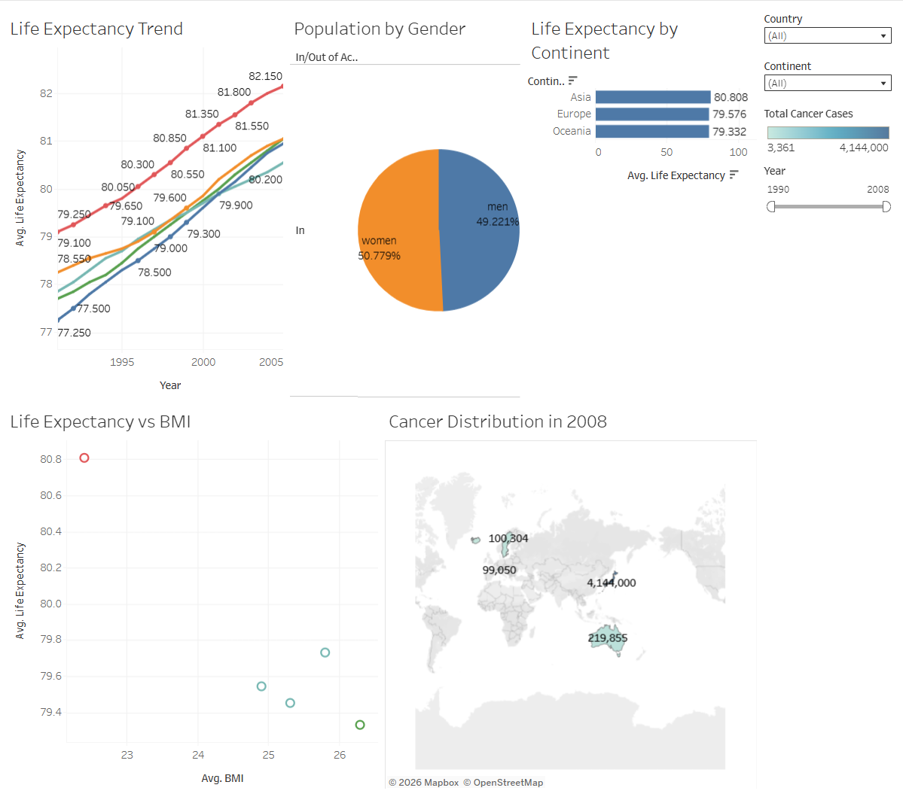

# 📊 Tableau Business Intelligence & Visual Analytics Portfolio

*A comprehensive collection of interactive dashboards and analytical explorations built during the Data Technician programme.*

---

## 🎯 Executive Summary

This repository highlights my technical proficiency in leveraging **Tableau Desktop** and **Tableau Public** to transform complex, multi-source raw data into compelling, interactive visual narratives. The projects focus on uncovering hidden trends, evaluating socio-economic and demographic indicators, and designing user-centric analytical layouts.

---

## 💡 Core Competencies & Skills

### 📊 Advanced Dashboard Architecture
* Designing multi-dimensional, synchronized dashboards for executive and operational review.
* Integrating geographic maps, hierarchical bar structures, KPI metric cards, and dynamic filter actions into a unified canvas.
* Structuring intuitive layouts that prioritize visual hierarchy, whitespace management, and user interactivity.
* Deploying and sharing live interactive reports via cloud environments.

### 📈 Visual Analytics & Encoding
* Constructing comparative bar charts, multi-line chronological trends, and spatial filled-map projections.
* Implementing advanced scatter plots for correlation analysis and trend detection.
* Strategic application of color theory, shape encoding, and continuous scales to enhance data storytelling.

### 🔍 Analytical Problem Solving
* Extracting behavioral patterns, anomalies, and macroeconomic correlations from large-scale structured datasets.
* Evaluating cross-domain metrics (e.g., assessing health outcome disparities against BMI benchmarks[cite: 19], or analyzing popularity-to-danceability vectors in media repositories[cite: 19]).
* Translating raw quantitative outputs into actionable strategic recommendations for organizational decision-making[cite: 19].

### ⚙️ Platform Evaluation & Governance
* Comparative assessment of ecosystem capabilities across **Tableau Desktop**, **Tableau Server**, **Tableau Online**, **Tableau Public**, and **Tableau Mobile**[cite: 18].
* Managing and recognizing platform constraints, such as public cloud hosting mandates, connector boundaries, and workspace data limits[cite: 18].

---

## 🗂 Repository Contents

* **GB Employment Analysis:** Regional workforce dynamics, industry distributions, and geographic shift mappings.
* **Global Health Insights:** Longitudinal population metrics, health risk correlations, and continental benchmarks.
* **Spotify Track Performance:** Audio feature metrics, genre popularity distribution, and listening trends.
* **Dashboard Snapshots:** High-resolution visual evidence of completed reporting interfaces.
* **Technical Documentation:** Methodological notes and analytical takeaways.

---

## 🚀 Key Takeaways & Impact

Through these applied projects, I demonstrated the ability to:
* Bridge the gap between raw data storage and interactive business intelligence.
* Construct spatial analyses using geographic coordinate mapping.
* Deliver polished, presentation-ready insights tailored to stakeholder needs.
* Integrate data visualization workflows smoothly into a broader analytical pipeline[cite: 20].

*Selected Highlight:* In the Health Dataset exploration, analyzing BMI correlations provided clear indicators valuable for targeted public health interventions[cite: 20].

---

## 🧰 Technologies & Tooling

* Tableau Desktop & Tableau Public Ecosystem[cite: 20]
* Spatial mapping & geographic coordinate layers[cite: 20]
* Data blending, calculated fields, and visual analytics controls[cite: 20]

---

## 📸 Interactive Dashboards

### 1. Employment & Workforce Analytics
* **Overview:** Comprehensive analysis of regional employment shifts and industrial distribution across Great Britain.
* [🔗 View and Interact on Tableau Public](https://public.tableau.com/) *(замените на вашу ссылку)*

### 2. Global Health & Demographics
* **Overview:** Multi-faceted exploration of life expectancy trends, gender distributions, and health risk indicators across global populations.

  
    [🔗 View and Interact on Tableau Public](https://public.tableau.com/app/profile/tymofii.moshkovskyi/viz/GlobalHealthDashboard_17900791982420/GlobalHealthDashboard)

### 3. Spotify Audio & Popularity Metrics
* **Overview:** Data-driven evaluation of track characteristics, genre preferences, and streaming trends.
* [🔗 View and Interact on Tableau Public](https://public.tableau.com/app/profile/tymofii.moshkovskyi/viz/SpotifyMusicFeaturesPopularityDashboard/SpotifyMusicFeaturesPopularityDashboard)
